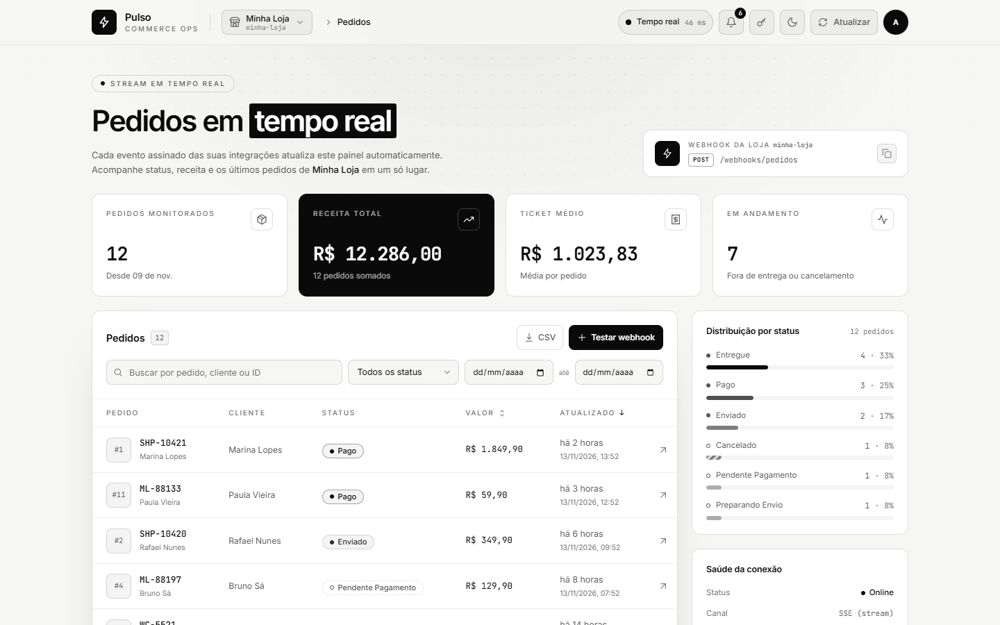
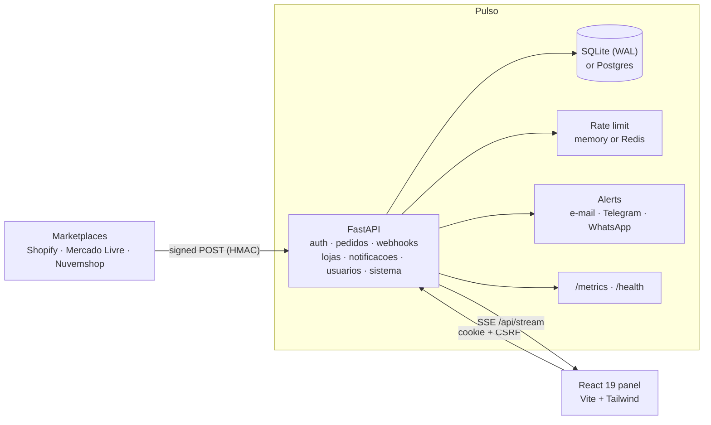
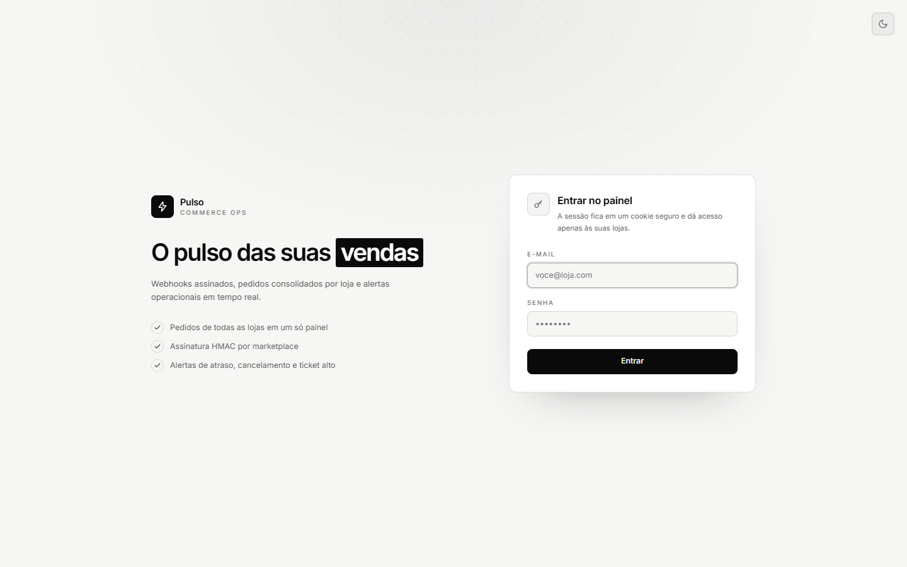
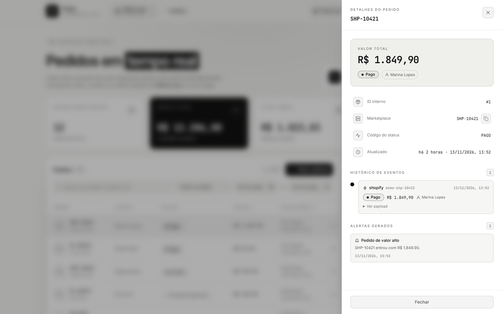
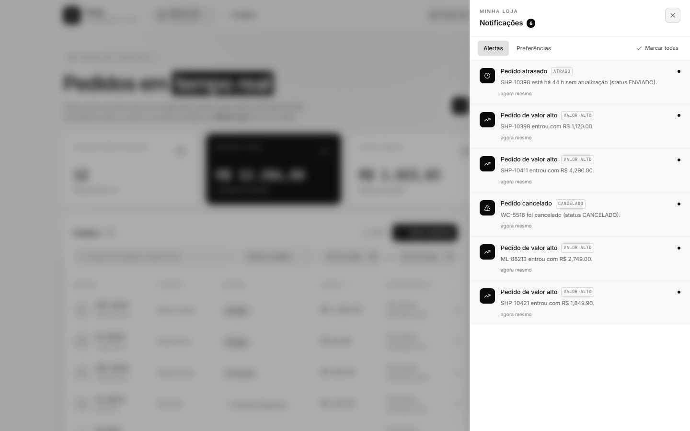
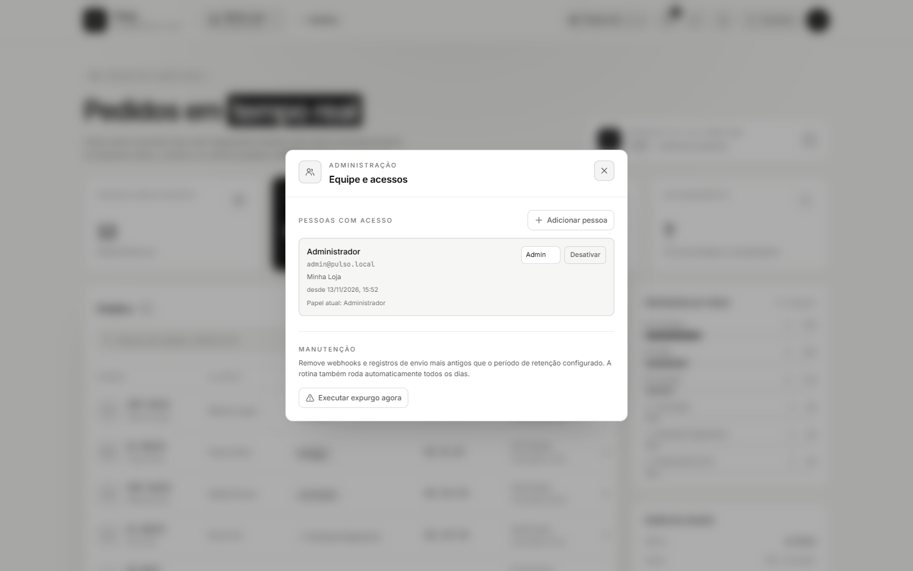
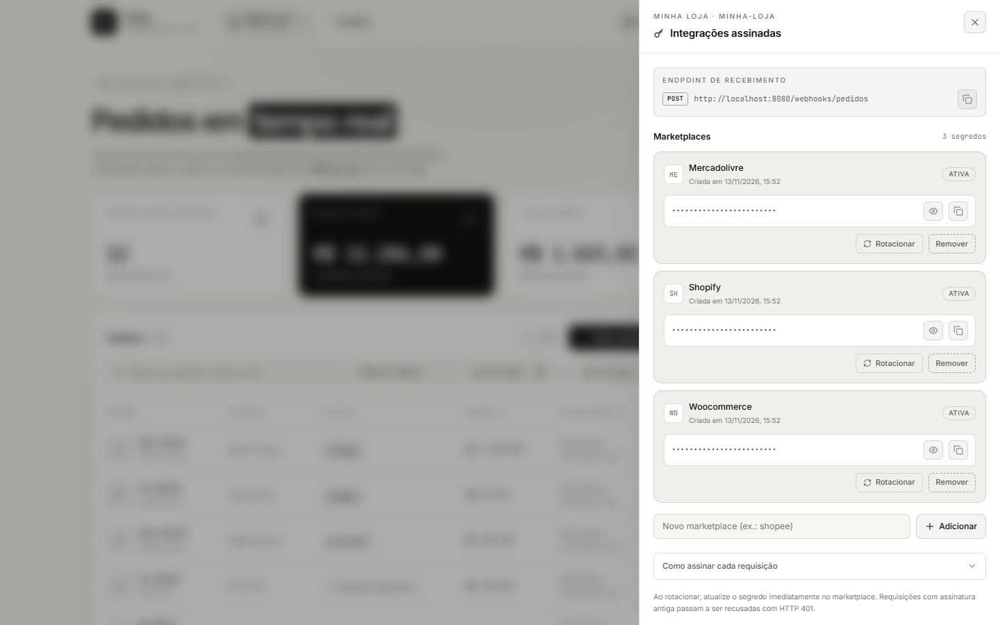
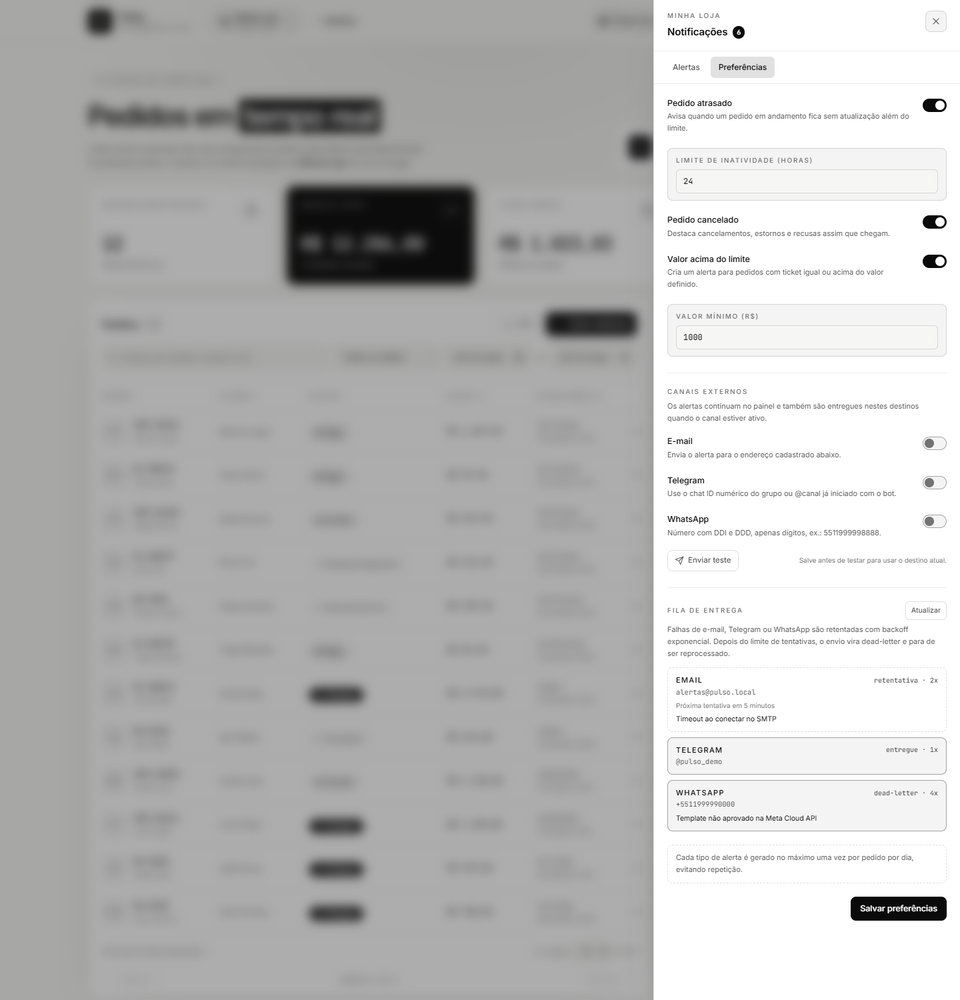

# Pulso · Real-time order monitoring from webhooks

Operations dashboard that receives signed marketplace webhooks, consolidates orders per store and alerts the team in real time when something needs attention.

[Português](README.md) · [](https://github.com/VictorStavarengo/pulso-webhooks/actions/workflows/ci.yml)



> **Live demo:** **https://pulso-api-2uc9.onrender.com** · sign in with `demo@pulso.dev` / `Pulso-Demo-2026`. All data is fictional and reseeded on every deploy; the free plan sleeps after 15 minutes, so the first visit can take about a minute.

> **One-command local demo:** `PULSO_DEMO_SEED=1 PULSO_ALERTAS_EXTERNAS=0 docker compose up --build` → `http://localhost:8000` with `admin@pulso.local` / `pulso123`, 12 orders, integrations, notifications and a pre-filled delivery queue. Public demo steps are under [CI and deployment](#ci-and-deployment).

[](https://render.com/deploy?repo=https://github.com/VictorStavarengo/pulso-webhooks)

## The problem

Stores selling on multiple marketplaces (Shopify, Mercado Livre, Nuvemshop…) receive dozens of webhooks per day in different formats. Without a consolidation layer, the team finds out about delayed orders, cancellations and high-value sales too late — and every integration becomes an isolated script with no signature validation, idempotency or visibility.

Pulso solves this in one place:

- validates the HMAC signature of every event before accepting data;
- keeps the latest order state per `pedido_id` plus a full event history;
- detects delay, cancellation and high-value orders, then alerts via e-mail, Telegram or WhatsApp;
- streams updates to the dashboard over SSE, with filters, pagination and CSV export.

## Features

| Area | What works today |
| --- | --- |
| Ingestion | `POST /webhooks/pedidos` with HMAC-SHA256, timestamp tolerance, `evento_id` deduplication and per-IP/store rate limiting |
| Orders | Paginated list, search, status/date filters, sorting, revenue summary, average ticket and CSV export |
| Order detail | Full event history with each payload and the alerts it generated |
| Real time | SSE at `/api/stream` (in-memory hub or Redis) updates the panel without reloading |
| Multi-store | Store isolation, active-store switching, per-store alert settings |
| Team | `admin` and `operador` roles, invitations, protection against removing the last admin |
| Security | Signed session cookie, double-submit CSRF, optional TOTP 2FA, scrypt password hashing, login rate limit |
| Operations | Automatic log retention, `/health`, Prometheus `/metrics`, optional Sentry, structured logs |
| Alerts | E-mail (SMTP), Telegram and WhatsApp Cloud API, with a channel test in the panel |
| Reliability | Delivery queue with exponential backoff; persistent failures become **dead letters** visible in the panel and via API |

## Architecture



Design decisions worth highlighting:

- **One image, one origin.** The Docker image builds the React panel and FastAPI serves it (`PULSO_SERVIR_FRONTEND=1`). Session and CSRF cookies stay same-origin, avoiding fragile CORS setups.
- **Optional infrastructure.** SQLite + in-memory run with zero setup; `DATABASE_URL` and `REDIS_URL` scale to Postgres and Redis without code changes.
- **Business logic outside routes.** Event consolidation lives in `servicos.py`, so HTTP and tests share the same path.
- **Channel failures do not lose alerts.** Every external delivery attempt is stored in `envios_alerta`. On error, a worker reschedules with backoff (`60s → 5min → 15min`). After the configured attempts the row becomes `descartado` (dead letter) and stays queryable via `GET /api/lojas/{id}/alertas/envios`.

## Stack

| Layer | Technologies |
| --- | --- |
| API | Python 3.13, FastAPI, Pydantic 2, SQLAlchemy 2, Uvicorn |
| Database | SQLite with WAL by default, optional Postgres, Alembic migrations |
| Frontend | React 19, TypeScript, Vite 8, Tailwind CSS 4 |
| Security | scrypt, HMAC-SHA256, TOTP (pyotp), double-submit CSRF |
| Observability | Prometheus (`prometheus-client`), Sentry, JSON logs |
| Quality | pytest (64 tests), Playwright E2E, ESLint, GitHub Actions |
| Delivery | Multi-stage Docker, Docker Compose, Render Blueprint |

## Running locally

Requirements: Python 3.13+, Node 22+.

```bash
# API
python -m venv .venv
source .venv/bin/activate          # Windows: .venv\Scripts\activate
pip install -r requirements-dev.txt
cp .env.example .env               # fill only what you need
uvicorn main:app --reload

# Panel (second terminal)
cd frontend
npm install
npm run dev
```

Panel at `http://localhost:5173`, API at `http://localhost:8000` (Vite proxies `/api`, `/webhooks` and `/health`).

Or run everything with Docker:

```bash
docker compose up --build
# panel + API at http://localhost:8000
```

Initial credentials created on first boot:

| Role | E-mail | Password |
| --- | --- | --- |
| Admin | `admin@pulso.local` | `pulso123` |

Change them with `PULSO_ADMIN_EMAIL` and `PULSO_ADMIN_SENHA` **before** exposing the app. Additional operators can be invited in **Account menu → Team & access**.

## Webhook contract

```http
POST /webhooks/pedidos
Content-Type: application/json
X-Pulso-Loja: my-store
X-Pulso-Marketplace: shopify
X-Pulso-Timestamp: 1762900000
X-Pulso-Evento: evt_123
X-Pulso-Assinatura: <hex hmac-sha256>

{"origem":"shopify","pedido_id":"BR-1042","status":"PAGO","valor":349.9,"cliente_nome":"Mariana Alves","evento_id":"evt_123"}
```

The signature is `HMAC-SHA256(secret, timestamp + "." + raw_body)` in hexadecimal. Python example:

```python
import hashlib, hmac, json, time, urllib.request

secret = "integration-secret"  # shown in Integrations & secrets
body = json.dumps({
    "origem": "shopify", "pedido_id": "BR-1042", "status": "PAGO",
    "valor": 349.9, "cliente_nome": "Mariana Alves", "evento_id": "evt_123",
}).encode()
timestamp = str(int(time.time()))
signature = hmac.new(secret.encode(), timestamp.encode() + b"." + body, hashlib.sha256).hexdigest()

request = urllib.request.Request(
    "http://localhost:8000/webhooks/pedidos",
    data=body,
    headers={
        "Content-Type": "application/json",
        "X-Pulso-Loja": "my-store",
        "X-Pulso-Marketplace": "shopify",
        "X-Pulso-Timestamp": timestamp,
        "X-Pulso-Evento": "evt_123",
        "X-Pulso-Assinatura": signature,
    },
)
with urllib.request.urlopen(request) as response:
    print(response.status, response.read().decode())
```

Replays with the same `evento_id` are reported as duplicates and never overwrite the order.

## API

- `POST /webhooks/pedidos` — signed event ingestion.
- `GET /api/pedidos` — paginated list with search, status and date filters.
- `GET /api/pedidos/exportacao.csv` — CSV export of the current filter.
- `GET /api/pedidos/{id}` — order detail with event history and alerts.
- `GET /api/stream` — SSE real-time updates.
- `GET/POST /api/lojas`, `PATCH /api/lojas/{id}/configuracoes` — stores and alert settings.
- `POST /api/lojas/{id}/alertas/teste` — test every configured channel.
- `GET /api/lojas/{id}/alertas/envios` — delivery queue with `status`, `tentativas`, next attempt and error (admin).
- `GET/POST /api/lojas/{id}/integracoes`, `POST /api/integracoes/{id}/rotacionar` — per-marketplace secrets.
- `GET /api/notificacoes`, `POST /api/notificacoes/{id}/ler` — in-app alerts.
- `GET/POST /api/usuarios`, `PATCH /api/usuarios/{id}` — team management (admin).
- `POST /api/auth/login`, `POST /api/auth/2fa`, `POST /api/auth/logout`, `GET /api/auth/me` — authentication.
- `GET /health`, `GET /metrics`, interactive docs at `/docs`.

## Tests

```bash
pip install -r requirements-dev.txt
python -m pytest -q      # 64 tests
```

Covers authentication, CSRF, 2FA, roles, webhook signatures, idempotency, pagination, alert retry/dead-letter, retention, Alembic migrations, metrics and rate limiting on a disposable SQLite database.

End-to-end suite:

```bash
cd e2e
npm install
npx playwright test            # headless
npm run test:headed            # watch it run in Chrome
```

The E2E test is self-contained: it builds the panel, starts the API on `127.0.0.1:8010` with a disposable SQLite file, seeds orders through the authenticated simulator, then validates login → order list → detail drawer → notification panel → delivery queue and a new order arriving over SSE without a page reload. Failures keep a trace and screenshot under `e2e/test-results/`.

## CI and deployment

GitHub Actions runs three jobs on every push and pull request: pytest, frontend lint + production build, and the Playwright flow on Chrome.

The same Docker image serves API and panel, which keeps deployment simple. The public demo runs as a single service with no external database:

1. Create a Render Blueprint from the repository. [`render.yaml`](render.yaml) provisions one Docker service with SQLite inside the container and `PULSO_DEMO_SEED=1`. Set `PULSO_ADMIN_EMAIL`/`PULSO_ADMIN_SENHA` in the dashboard using demo-only credentials.
2. The Blueprint enables Render's native auto-deploy on every push to `main`. To deploy from GitHub Actions instead, copy the Render deploy hook into the `RENDER_DEPLOY_HOOK` secret; [`deploy-render.yml`](.github/workflows/deploy-render.yml) runs it and is skipped when the secret is absent. Pick one path to avoid duplicate builds.
3. On the first boot of an empty database, the demo gets 12 orders, 3 integrations with secrets, notifications and a delivery queue holding one pending retry and one dead letter. Sign in and open **Webhook simulator** to create new orders live over SSE.

Fly.io and Railway work with the same Dockerfile, the `$PORT` variable and a volume mounted at `/dados`. GitHub Pages is not an option: it only serves static files and cannot run FastAPI.

> Render's free plan has no persistent disk: every restart or deploy recreates the SQLite database and reseeds the demo, which keeps the link clean at zero cost. The service sleeps after 15 minutes of inactivity, so the first load can take about a minute.

## Security

- Passwords hashed with **scrypt** (`n=16384, r=8, p=1`) and per-user salt; constant-time comparison.
- Session in an HMAC-signed `httpOnly` cookie with a 7-day expiry; `Secure` enabled per environment.
- **Double-submit CSRF** (`pulso_csrf` cookie + `X-Pulso-Csrf` header) on every authenticated write.
- Optional **TOTP 2FA** per user, with a 5-minute pending cookie.
- Webhooks require a valid HMAC, a timestamp inside tolerance, a matching origin and a unique `evento_id`.
- Rate limiting on login, 2FA and webhooks; local memory or Redis.
- `admin`/`operador` roles, per-store isolation and guards against leaving a store without an admin.
- `.env`, local databases, backups and the session secret file are git-ignored.

## Screenshots

| Login | Orders in real time |
| --- | --- |
|  |  |

| Order detail | Notifications |
| --- | --- |
|  |  |

| Team & access | Signed integrations |
| --- | --- |
|  |  |

### Delivery queue

Every external alert goes through a queue with exponential backoff and dead-lettering. The panel shows the current attempt, the provider error, the scheduled retry — or why the send was discarded.



## Known limitations

- The local SSE hub serves a single worker; use `REDIS_URL` to scale horizontally.
- The retry loop uses an in-process lock. With multiple workers, run a dedicated worker or replace the lock with Redis/advisory locks to avoid duplicate sends.
- WhatsApp alerts require a template approved by Meta Cloud API.
- Retention purges webhook logs and delivery records, not orders.
- The Render free demo runs SQLite on ephemeral disk: restarts wipe data and the first request after sleep can take about a minute.
- No ready-made marketplace OAuth flow; each store registers its endpoint and secret under **Integrations**.

## License

[MIT](LICENSE) © 2026 João Victor
